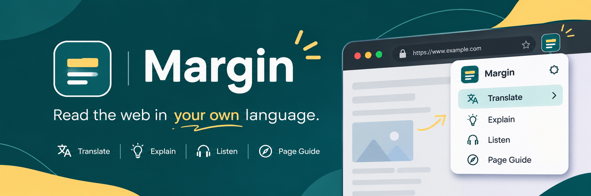
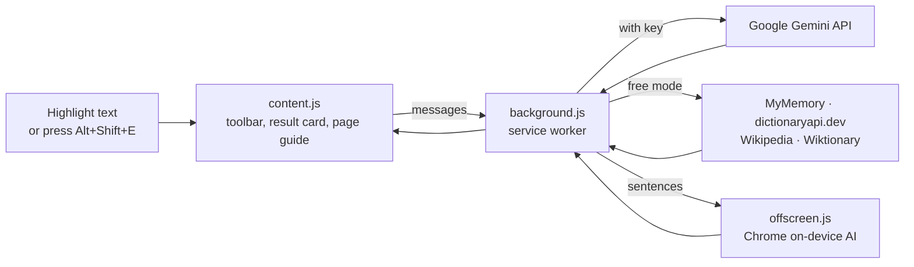

  

# Margin

### Read the web in your own language.

Select text to **translate**, **explain** or **hear** it. Right-click any page for a plain-language guide to its buttons and forms.

<!-- Add a screenshot or GIF here, e.g. docs/demo.gif -->

  

---

## The problem

The web is built for people who read English fluently and already know how interfaces work. Millions of people don't:

- A **Hindi, Tamil or Bengali speaker** hits a wall of English text, jargon or legal terms.
- A **first-time smartphone or computer user** faces a checkout page with ten buttons and no idea which one charges their card.

Copy-pasting into a translator breaks your flow, and most tools never tell you what a button *does*.

## What Margin does

| | Feature | What you get |
| --- | --- | --- |
| 🌐 | **Translate** | Highlight text and get a translation in a card right beside it, with a picker for any supported language. |
| 💡 | **Explain** | Plain, friendly explanations of hard sentences, jargon or tone, in your language. |
| 🔊 | **Listen** | Read the selection aloud in the right voice for its script. |
| 📖 | **Word meanings** | Select one word and see its meaning from Wiktionary and Wikipedia, with a link to read more. |
| 🧩 | **Tricky words** | Select a longer passage and the difficult words are listed with short meanings. |
| 🧭 | **Page guide** | Press `Alt+Shift+E` for an overlay that explains every button, link and form field, what to do next, and warns about anything that costs money or is hard to undo. Hover an item to highlight it on the page. |

**Supported languages:** English, Hindi, Spanish, French, German, Bengali, Tamil, Telugu, Marathi, Urdu.

<!-- Add screenshots here, e.g. docs/selection-card.png and docs/page-guide.png -->

## Quick start

1. **Download** this repo (`Code → Download ZIP`) and unzip it, or run `git clone https://github.com/deva23015/margin.git`.
2. Open `chrome://extensions` and switch on **Developer mode**.
3. Click **Load unpacked** and select the Margin folder.
4. *(Optional, for long text and AI page guides)* Click the Margin icon → **Settings**, paste a free [Gemini API key](https://aistudio.google.com/apikey) and press **Save**.
5. *(Optional, free and offline)* Prefer no API key? Open **Settings → On-device AI** and press **Download model**. This downloads Chrome's built-in Gemini Nano (a one-time download of a few GB) so Margin can explain sentences on your device, privately and offline. Keep the popup open until it finishes. Chrome needs a recent desktop version and about 22 GB of free disk space, and if your computer can't run it, Margin still works in free mode.
   
Pages that were already open need a reload for the selection toolbar. The popup and right-click menu work immediately.

## Works without a key

Margin is useful before you set anything up.

| Mode | Translate | Explain | Page guide |
| --- | --- | --- | --- |
| **Free** (no key) | Short text via MyMemory | Single words via a dictionary; sentences via Chrome's on-device AI | Rule-based guide, works offline |
| **With Gemini key** | Any length | Fuller plain-language explanations | AI guide written for the specific page |

**On-device AI (optional):** Chrome's built-in model (Gemini Nano) can explain sentences for free, offline and privately. It needs a recent desktop Chrome and roughly 22 GB of free disk space. Turn it on in Settings.

## How it works

The page guide reads only what is visible: the title, headings, a text excerpt and button labels. It turns each control into a numbered entry the model can refer to, then maps the answer back onto the page so hovering highlights the real element.

## Privacy

- Your key is stored in `chrome.storage.local` and never leaves your browser except in requests to Google.
- **With a key:** the selected text, or the page's title, headings, visible text and button labels, is sent to Google's Gemini API.
- **Free mode:** the selected text goes to `api.mymemory.translated.net` and `api.dictionaryapi.dev`.
- **Single word selected:** that word is also looked up on Wikipedia and Wiktionary, with or without a key.
- **Anything typed into form fields, including passwords, is never read or sent.**
- Page text is passed to the model as untrusted data, so instructions hidden in a web page can't steer it.

## Project structure

| File | Role |
| --- | --- |
| `manifest.json` | Permissions, keyboard shortcut, content script |
| `background.js` | Context menu, shortcut, Gemini API calls, Wikipedia/Wiktionary and dictionary lookups |
| `content.js` | Selection toolbar, result card placed beside the selection, page guide overlay (closed shadow DOM) |
| `offscreen.html` / `offscreen.js` | Hidden page that runs Chrome's on-device AI |
| `popup.html` / `popup.css` / `popup.js` | Quick actions and settings |

## Tech

Chrome Extension (Manifest V3) · vanilla JavaScript, no build step · Google Gemini API · Chrome Prompt API (Gemini Nano) · Web Speech API · Wikipedia and Wiktionary REST APIs

## Known limitations

- Doesn't run on `chrome://` pages, the Chrome Web Store or the built-in PDF viewer.
- Free translation is limited to roughly 450 bytes of text per request.
- On-device AI answers in English, Spanish, French or German; other languages get a translated answer.

## 👥 Meet the Team

### Built with creativity, collaboration and a shared vision.

**Team Ghostriders** — the minds behind Margin.

We believe technology should make the internet more accessible, understandable and inclusive for everyone.

---

| Team Member | Github Username |
|:---:|:---:|
| **Advait** | advaitFlux |
| **Devansh** | deva23015 |
| **Omkar** | leluchvigeass-svg |
| **Atishay** | atishya-jain-1708 |

### 🤝 Our Mission

We came together to build Margin — a browser companion designed to break language barriers and make the web easier for everyone to navigate.

**One team. One vision. A more accessible web.**

---

**Made with ❤️ by Team Ghostriders**

## License

MIT. See [LICENSE](LICENSE).
